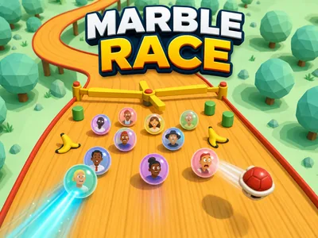
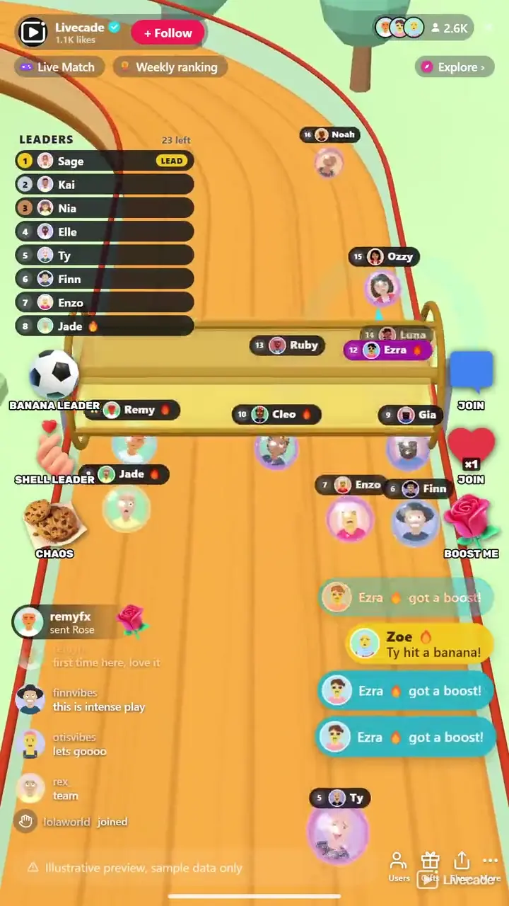

# Marble Race - Interactive TikTok Live Game

> Every viewer races their own marble, with their face inside, down a 3D marble run.

Every viewer races their own marble, with their profile photo inside, down a 3D marble run of up to 80 marbles. Gifts boost a marble, slip the leader on a banana, hit them with a shell, or set off Chaos for the whole pack.

**[Play Marble Race on Livecade](https://livecade.io/games/marble-race/?utm_source=github&utm_medium=readme&utm_campaign=marble-race)** - runs as a single browser source in OBS, Streamlabs, or TikTok LIVE Studio. Nothing for viewers to install.

## How viewers play

Viewers take part with the actions TikTok already gives them: **comments**, **gifts**, **likes**. Every action below is rebindable, so you decide which interaction drives which effect.

| Action | What it does |
| --- | --- |
| **Join the race** | Drops the viewer's marble into the start box while the lobby is open. Any comment or a like by default |
| **Boost my marble** | Pushes the sender's marble forward with extra speed for 2.5 seconds. A Rose by default |
| **Banana the leader** | A banana peel lands in front of the leader and they skid. A Football by default |
| **Shell the leader** | A shell skims up the lane and knocks the leader back. A Finger Heart by default |
| **Chaos (all marbles)** | Shakes every marble in the pack and can throw some off the track. A Choc Chip Cookie by default |

## How it works

### A comment drops you in

Any comment or a like joins the next race, up to 80 marbles. The lobby stays open for 45 seconds by default and starts early when it is full.

### Boost your own marble

A boost pushes the sender's marble forward with extra speed for 2.5 seconds. A boost from a viewer who is not racing goes to the marble in last place, in their name.

### Hit the leader

A banana makes the leader skid and a shell knocks them back. Chaos shakes the whole pack, and it is the only gift that can throw a marble off the track.

### Rounds and a winner

Elimination rounds knock out the back of the field each race until one marble is left, or run a single race. The top 3 get finish cards and the winner gets the camera.

## About the game

Marble Race turns your TikTok Live into a marble run. Everyone who comments drops into the start box as a glass marble with their profile photo inside, up to 80 of them, and when the gate opens the whole pack rolls down the course. A tag above each marble shows the viewer's place and name, and a live ranking shows who is out front.

### Four maps full of obstacles

Funnels squeeze the pack, spinners and pendulums knock marbles aside, windmills scoop them ahead, and bumpers, pegs, spring pads and ledges send them bouncing down to the next level. A fast launcher wheel throws unlucky marbles off the track. Pick Classic, Candy, Ice or Desert canyon, or a random map each race, in three lengths from about 40 seconds to a minute and a half.

### Gifts change the race

Out of the box a Rose boosts the sender's own marble, a Football drops a banana in front of the leader, a Finger Heart fires a shell at the leader, and a Choc Chip Cookie sets off Chaos, which shakes the whole pack and can throw marbles off the track. Every send gets its own card with the sender's photo and name, and the camera holds on the marble it hit. Gifts sent between races are saved and go off just after the next start.

### Elimination rounds or a single race

In elimination mode the last 5 marbles of each race are out and the rest race again, round after round, until one winner is left. A single race crowns the first marble across the line. The top 3 get finish cards, and the winner gets a card with their photo while the camera stays on their marble.

## What it looks like on stream

[Watch Marble Race gameplay](https://cdn.livecade.io/games/marble-race.mp4)

## What you can configure

- **Overlay language** - Thirteen languages for everything on screen
- **Map** - Classic, Candy, Ice or Desert canyon, or a random map each race
- **Race length** - Short, medium or long: about 40 seconds, 1 minute or 1.5 minutes
- **Race mode** - Elimination rounds that thin the field, or a single race
- **Eliminated per round** - How many marbles drop out at the back of each round, 5 by default
- **Lobby length** - 15 to 120 seconds for viewers to join, 45 by default
- **Max marbles** - 10 to 80 marbles on the track, 24 by default. A full lobby starts the race early
- **Leaderboard** - Show the live ranking, with 3 to 12 entries

## Languages

English, Spanish, Portuguese, French, German, Italian, Indonesian, Arabic, Turkish, Russian, Hindi, Romanian, Filipino

## FAQ

<strong>How do viewers join Marble Race?</strong>

Viewers comment anything in your TikTok Live chat, or tap like, while the lobby is open. Each one gets their own marble with their profile photo inside, up to 80 in a race.

<strong>Do viewers need to send gifts to play?</strong>

No. Joining is free, and any viewer can race and win without a gift. Gifts boost a viewer's own marble or hit the leader with a banana, a shell or Chaos.

<strong>How long is a race?</strong>

You choose short, medium or long: about 40 seconds, a minute or a minute and a half, on any of the four maps. Elimination mode runs rounds until one winner is left.

<strong>Can I change which gifts do what?</strong>

Yes. Every action can be bound to any gift, a comment, likes, a follow or a share, with a minimum coin amount if you want one.

<strong>How do I add Marble Race to my TikTok Live?</strong>

Add one browser source URL to OBS or your streaming software and go live. There is no plugin to install and nothing for your viewers to download.

## Setup

1. [Create a Livecade account](https://app.livecade.io/register?utm_source=github&utm_medium=cta&utm_campaign=marble-race)
2. Copy your overlay browser source URL
3. Paste it into OBS, Streamlabs, or TikTok LIVE Studio
4. Pick Marble Race, set your triggers, and go live

Runs in the browser, so it works on Windows and macOS with nothing to download. [See all TikTok Live games](https://livecade.io/tiktok-live-games/?utm_source=github&utm_medium=readme&utm_campaign=marble-race).

---

_This repository documents Marble Race, a hosted interactive game by [Livecade](https://livecade.io/?utm_source=github&utm_medium=footer&utm_campaign=marble-race). The game runs on Livecade's platform, so there is no source to install here._
